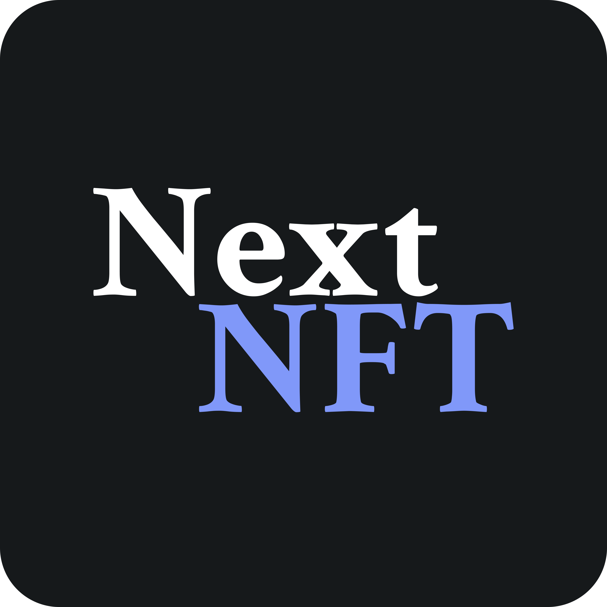
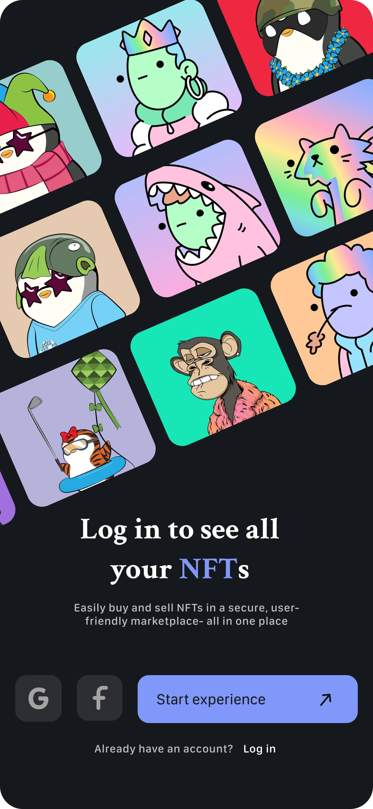
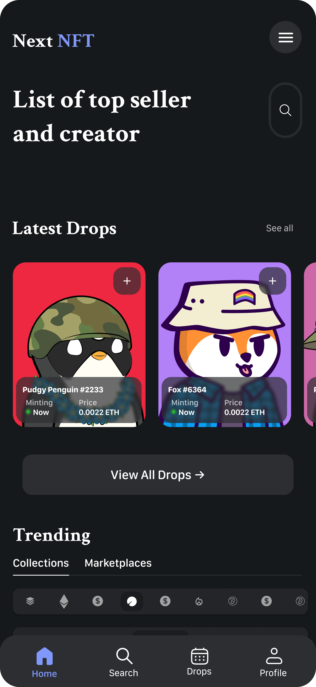

<p align="center">
  
</p>

<h1 align="center">NextNFT</h1>

<p align="center">
  <b>Discover • Search • Explore NFTs</b>
</p>

<p align="center">
  Modern iOS NFT explorer built with SwiftUI, MVVM & Clean Architecture
  


</p>

<p align="center">
  NextNFT is a modern iOS application for discovering NFT collections and NFTs using the **OpenSea API**.  
The app is built with **SwiftUI**, follows **MVVM + Clean Architecture**, and focuses on clean separation of concerns, scalability, and real-world production patterns....
  
</p>

<p align="center">
  UI/UX Design crafted independently in Figma  
  <br/>
  <a href="https://www.behance.net/gallery/230704837/NextNFT">View Full Project</a>
</p>

---

## Preview

<p align="center">
  
  
  
</p>

---

## Features

- Search NFT collections and NFTs
- Debounced search for better performance
- Recent collections section
- Async/Await networking
- Clean Architecture + MVVM
- Easily testable business logic

---

## Tech Stack

- **Language:** Swift 6 (strict concurrency checking)
- **UI:** SwiftUI
- **Architecture:** MVVM + Clean Architecture, with a composition root (`AppContainer`)
- **State:** Observation (`@Observable`) with a shared `ViewState`
- **Concurrency:** async / await
- **Networking:** URLSession
- **Testing:** Swift Testing
- **API:** OpenSea API (v2)

---

## Project Structure

```
NextNFT/NextNFT
├── App/          Entry point, AppContainer (builds all dependencies), environment values
├── Core/
│   ├── Domain/   Shared entities (NFT, NFTCollection) and repository protocols
│   ├── Data/     Shared repository implementations
│   ├── Download/ Image download, copy and save-to-Photos
│   └── Presentation/ ViewState
├── Features/     Home, Search, Drops, Start, TabBar — each with Domain / Data / Presentation
├── Network/      Endpoints, DTOs, data sources, NetworkService
└── Extensions/   Helpers (colors, logging, image color analysis)
```

The app sources are a synchronized folder in Xcode, so new files are picked up automatically.

Run the tests with **Cmd+U** in Xcode.

---

### API

All NFT data is fetched from the **OpenSea API**:

- Base URL: `https://api.opensea.io/api/v2`
- Docs: [OpenSea API Documentation](https://docs.opensea.io/reference/api-overview)

---

## Setup

API keys are kept out of git. Before building:

1. Get an API key from [OpenSea](https://docs.opensea.io/reference/api-keys).
2. Create your local config from the template:
   ```bash
   cd NextNFT
   cp Config.example.xcconfig Config.xcconfig
   ```
3. In `Config.xcconfig`, set `OPENSEA_API_KEY`, and set `API_KEY` to the Firebase API key from your `GoogleService-Info.plist`.

`Config.xcconfig` is gitignored. Xcode uses it as the app target's base configuration, and `Info.plist` passes both keys to the app at runtime. If the Firebase key is missing, the app still runs but skips Firebase setup.
